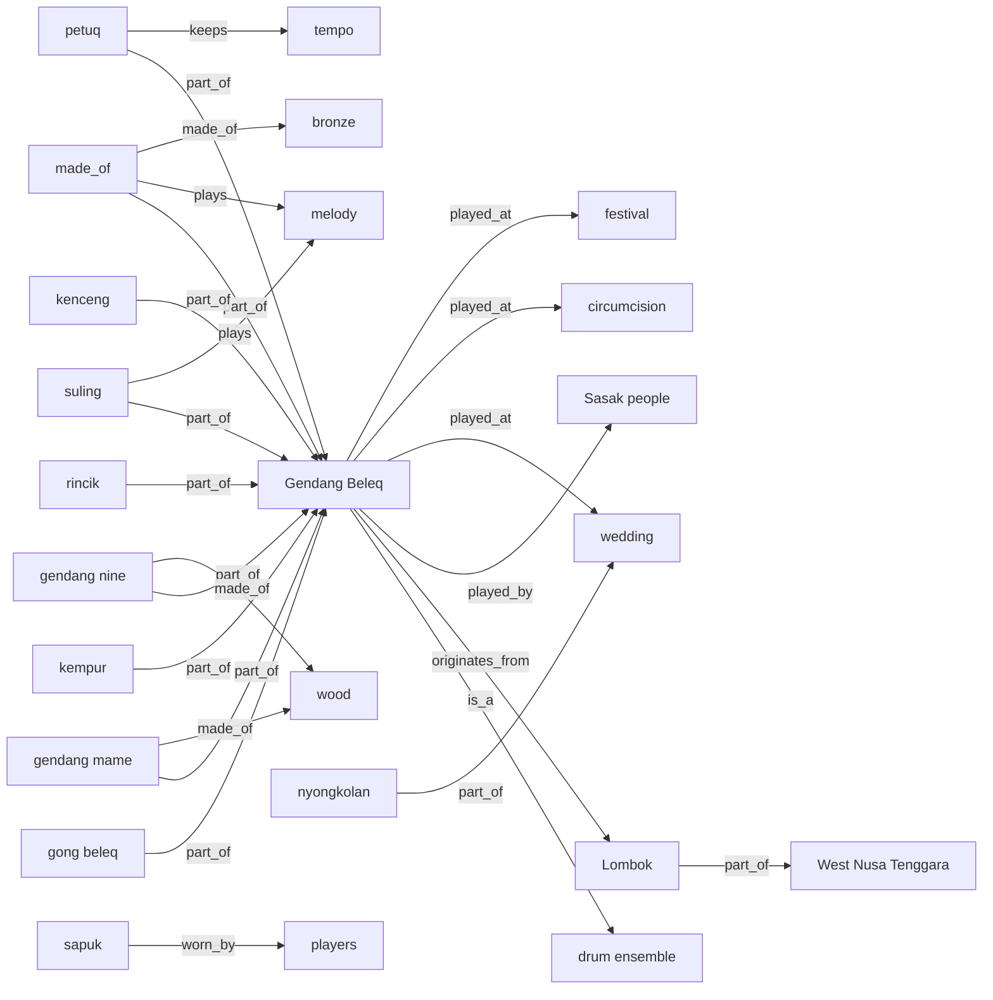
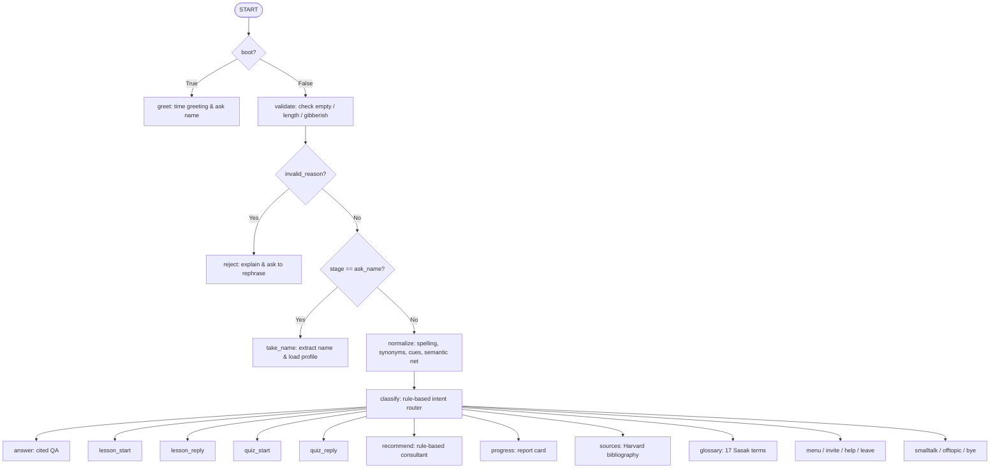

# Guru Beleq: Rule-Based Teaching Chatbot for the Sasak Gendang Beleq Ensemble

---

## Chapter 1: Introduction and System Persona

### 1.1 Background and Cultural Domain
The **Gendang Beleq** (also spelled *Gendang Belek*) is a traditional large-drum and percussion ensemble of the **Sasak people** of Lombok, West Nusa Tenggara (*Nusa Tenggara Barat*, NTB), Indonesia (Saputra, 2019; Fazalani, 2020). Historically associated in community accounts with royal soldiers marching to battle and returning from war, the ensemble has evolved into a central emblem of Sasak cultural identity—accompanying wedding processions (*nyongkolan*), life-cycle ceremonies (*ngurisan*, circumcisions, *begawe beleq*), and public festivals (Saputra, 2019; Keen, 2015; Maharani, 2024). Today, practitioners and cultural scholars note growing concern over its decline as newer, lower-cost street music styles such as *kecimol* and street *dangdut* increasingly replace traditional ensembles at weddings (Saputra, 2019; Keen, 2015).

### 1.2 Objectives
**Guru Beleq** ("Big Teacher") was designed to preserve and teach knowledge about the Gendang Beleq through an interactive, accessible, rule-based conversational agent. The system satisfies the following engineering and pedagogical goals:
1. **Zero-LLM, Deterministic Architecture**: Built entirely in plain Python on top of a **LangGraph** `StateGraph` (`src/graph.py`, `src/nodes.py`) with no external LLM or paid API dependencies.
2. **Socratic Teaching & Assessment**: Guides learners step by step through structured lessons, checks comprehension in the learner's own words, provides hints on first misses, answers interrupting side questions before returning to the active lesson, and administers adaptive quizzes.
3. **Strict Harvard Referencing & Epistemic Humility**: Every factual statement, glossary definition, and semantic-network edge is backed by verified academic or primary sources (`data/knowledge/topics.json`, `data/sources/`). When historical origins are unproven, the bot explicitly states so rather than presenting folklore as established fact.

### 1.3 Persona Design (`src/persona.py`)
- **Name**: **Guru Beleq** — *Guru* is Indonesian for "teacher" and *beleq* is Sasak for "big", linking the chatbot's teacher role directly to the "Big Drum" (*Gendang Beleq*).
- **Proactive Time-Aware Greeting**: On startup (`boot=True`), Guru Beleq speaks first, greets the learner according to the computer's local time of day (`Good morning`, `Good afternoon`, or `Good evening`), introduces the meaning of its name, and asks for the learner's name.
- **Pedagogical & Affective Tone**:
  - Uses varied praise (`PRAISE`), gentle nudges on partial/missed answers (`GENTLE`), and empathetic comfort (`COMFORT`) when the NLP layer detects learner frustration or confusion (`mood == "struggling"`).
  - Awards progressive learner titles based on combined lesson and quiz points (`10 × lessons_done + 3 × quiz_right`):
    - `0–9 pts`: **Curious Listener**
    - `10–29 pts`: **Apprentice Drummer**
    - `30–54 pts`: **Gong Keeper**
    - `55+ pts`: **Master of the Big Drum**

### 1.4 GenAI Avatar Record (`assets/avatar.png`, `assets/AVATAR_LOG.md`)
The mascot avatar (`assets/avatar.png`) portrays Guru Beleq as a friendly cylindrical wooden Sasak drum with traditional rope lacing, round teacher spectacles, a red batik-patterned Sasak headcloth (*sapuk*), and padded drumsticks (*pemantok*) inside a circular badge frame. Full prompt history and refinements are logged in `assets/AVATAR_LOG.md`.

---

## Chapter 2: Knowledge Representation and Referencing

### 2.1 Structured Topic and Lesson Base (`data/knowledge/topics.json`)
The domain knowledge base is stored in `data/knowledge/topics.json` and validated by `src/knowledge.py` (`python -m src.knowledge`). It comprises:
- **6 Core Topics**:
  1. `overview` — *What is the Gendang Beleq?* (Sasak identity, geographic distribution across Central/East/West Lombok, competition from *kecimol* and *dangdut*).
  2. `name` — *What does the name mean?* (*gendang* = drum, *beleq* = big; alternative spelling *Gendang Belek*).
  3. `instruments` — *The instruments* (*gendang mame* / *nine*, 94 cm measured drum length, *randu*/*tap* wood and skin heads, *pemantok* mallet, melodic *suling* and *reyong*, rhythmic *gong beleq*, *kempur*, *petuq*/*oncer* tempo keeper, *rincik*, and *kenceng* cymbals).
  4. `occasions` — *When it is played* (*nyongkolan* wedding processions, circumcisions, *ngurisan*, *begawe beleq*, *Bau Nyale*, Sade and Ende tourism villages).
  5. `history` — *History and origins* (community accounts of accompanying royal warriors to battle and welcoming them home; scientific uncertainty regarding exact kingdom or date).
  6. `players` — *The players and their costume* (*sanggar* groups of 12 to 30+ musicians, marching/dancing while carrying heavy drums and gongs, traditional *sapuk* headcloth, *dodot* belt, *bebet* waist cloth, and group cohesion).
- **31 Cited Facts**: Each fact carries one or more reference keys (`saputra2019`, `fazalani2020`, `markarma2022`, `keen2015`, `maharani2024`, `indonesiatravel`).
- **12 Interactive Lesson Steps & 8 Extra Quiz Items**: Each item defines `question`, `answer` (concept groups of accepted synonyms), `hint`, and `explain`.
- **17 Sasak & Musical Glossary Terms**: Definitions with source keys for domain terms (`gendang`, `beleq`, `belek`, `sasak`, `nyongkolan`, `gendang mame`, `gendang nine`, `suling`, `reyong`, `petuq`, `oncer`, `kempur`, `rincik`, `kenceng`, `pemantok`, `sapuk`, `kecimol`).

### 2.2 Semantic Network (`data/knowledge/semantic_net.json`, `src/semantic_net.py`)
To represent domain relationships explicitly and widen search queries via **one-hop spreading activation**, the system maintains a 24-edge labelled semantic network across 9 relation types (`is_a`, `part_of`, `originates_from`, `played_by`, `played_at`, `made_of`, `worn_by`, `keeps`, `plays`).

When a user mentions a node (excluding the central hub `"Gendang Beleq"`, which would pull in the entire graph), `related_concepts()` in `src/semantic_net.py` retrieves up to 4 one-hop neighbour concepts and appends them to `search_query`.

---

## Chapter 3: Chatbot Architecture, NLP Pipeline, and Expert Modules

### 3.1 LangGraph State Machine (`src/graph.py`, `src/state.py`)
Conversation state is managed per thread by LangGraph's `MemorySaver` checkpointer (`State` in `src/state.py`), while long-term learner progress is persisted by name to `data/profiles.json`.

### 3.2 Input Validation Beyond Menu Options (`src/nlp.py`, `src/persona.py`)
1. **Pre-processing Guard (`validate_input`)**:
   - Rejects empty/whitespace-only inputs (`"empty"`).
   - Rejects overly long inputs exceeding 500 characters (`"too_long"`).
   - Rejects gibberish (`"gibberish"`) when fewer than 2 alphabetic letters are present, when letters make up less than 40% of a non-numeric message (e.g., `"?????"`), or when any character repeats 10+ times consecutively.
2. **Name Extraction (`extract_name`)**:
   - Extracts first names from natural sentences (*"Hello, my name is Ana"*, *"I'm Budi"*, *"call me O'Brien"*) or standalone names (*"Anne-Marie"*, *"José"*) while rejecting greetings, question words, and common stop words (`_NAME_STOP`).

### 3.3 Lightweight NLP Layer (`src/nlp.py`)
- **Two-Tier Spelling Correction (`correct_spelling`)**:
  - Tier 1 matches words of length $\ge 4$ against `_BASE_VOCAB` (core domain terms like `gendang`, `beleq`, `lombok`, `nyongkolan`, `petuq`) using `difflib.get_close_matches` (cutoff `0.79` for 4–5 letter words with a max length difference of 1 so `"look"` is never mangled into `"lombok"`, and `0.72` for longer words).
  - Tier 2 matches words of length $\ge 6$ against the full knowledge-base vocabulary (`cutoff=0.84`).
  - When a correction occurs, the bot transparently informs the user: `(I read that as: "...")`.
- **Synonym Expansion (`expand_synonyms`)**: Maps 10 canonical concepts (`gendang beleq`, `history`, `instrument`, `ceremony`, `performance`, `warrior`, `costume`, `meaning`, `sasak`, `lombok`) from 55 user phrasings (e.g., *"big drum ensemble"*, *"attire"*, *"origin"*).
- **Question-Type Cues (`question_cues`)**: Recognises 14 question patterns (*how many*, *how long*, *how to play*, *made of*, *when*, *where to see*, *where from*, *who plays*, *who invented*, *is it dying out*, *what does X do*, etc.) and injects target answer vocabulary into the search query—only when the question refers to the domain or uses an anaphoric pronoun (`it`, `they`, `them`), preventing off-topic questions like *"Who invented the guitar?"* from matching.
- **Follow-up Context Carryover**: When a user asks a short follow-up like *"tell me more"*, `normalize()` prepends the previous user turn to the search query and `answer()` filters out facts already stored in `state["told"]`.

### 3.4 TF-IDF Search and Partial-Match Admission (`src/search.py`, `src/nodes.py`)
Each fact and glossary entry is indexed with stemmed tokens (`nlp.stem`) and inverse document frequency:

$$\text{IDF}(w) = \ln\left(\frac{N + 1}{\text{df}(w) + 0.5}\right), \quad \text{Score}(d, q) = \frac{\sum_{w \in q \cap d} \text{IDF}(w)\cdot (1 + \ln \text{tf}(w, d))}{|d|^{0.25}} + \text{Boost}(d)$$

where $\text{Boost}(d) = 1.5$ if the query matches any of the topic's keywords or names a glossary term. If a query is un-cued, has no synonym expansion, has $\ge 2$ keywords, and shares $\le 50\%$ of its non-subject keywords (`search.coverage`) with the best-matching facts, Guru Beleq prefixes its answer with:
> *"I don't have an exact answer to that, but this is the closest I can tell you: ..."*

### 3.5 Expert Modules (`src/nodes.py`)
1. **Teacher Lesson Module (`lesson_start`, `lesson_reply`)**:
   - Selects a requested topic by keyword or defaults to the next unfinished topic.
   - Presents one teaching step at a time followed by a comprehension question.
   - Grades free-text answers via `concept_hit()`, which checks whether every required concept group is satisfied (tolerating plurals, prefixes, and 80% fuzzy character similarity).
   - Supports `"hint"`, `"repeat"`, `"skip"`, and `"stop"`, plus **mid-lesson side questions**: if a learner asks a question that is not an attempt at the current answer, Guru Beleq answers the question with citations and appends `_reprompt()` (*"Now, back to our lesson: ..."*).
2. **Adaptive Quiz Module (`quiz_start`, `quiz_reply`)**:
   - Draws up to 5 questions (`QUIZ_LENGTH = 5`), prioritising topics the learner has already studied (`lessons_done`).
   - Starts at difficulty `level = 1` and unlocks `level = 2` questions once the learner answers at least 2 questions correctly (`quiz["right"] >= 2`).
3. **Rule-Based Consultant / Recommender (`recommend`)**:
   - Scores every topic using an explicit heuristic:
     - `+3` if the learner has not completed the topic's lesson yet
     - `+2` per topic keyword mentioned in the learner's request
     - `+2` if the learner's quiz accuracy on that topic is below `60%`
     - `+1` if the learner previously asked questions about that topic (`topics_seen`)
   - Returns the top two recommendations together with human-readable reasons.
4. **Sasak Glossary Explorer (`glossary_node`)**:
   - Triggered via menu option `8` or keywords (`"glossary"`, `"dictionary"`, `"sasak terms"`), listing all 17 Sasak and organological terms with their meanings and Harvard citations.

### 3.6 Exception Handling and Persistence (`src/graph.py`, `src/profiles.py`)
- Every graph node is wrapped by `safe(fn, **on_error)` in `src/graph.py`, and `ask()` is guarded by a top-level `try/except`. Any unexpected runtime error is logged with full traceback while returning a friendly fallback (`ERROR_MESSAGE`) so the conversation never crashes.
- Learner profiles (`data/profiles.json`) are written atomically via a `.tmp` file replacement (`tmp.replace(f)`) and recover gracefully if the JSON file is missing or corrupted.

### 3.7 Web Frontends and Special Features (`server.py`, `web/index.html`, `app.py`)
Both the zero-dependency standard-library web server (`python server.py` on `http://localhost:8000`) and the Streamlit app (`streamlit run app.py` on `http://localhost:8501`) share a unified Sasak visual theme and provide:
- **Context-Aware Quick-Action Menu Bar**: One-click pills for menu options `1–8` and a direct lesson-topic picker in `menu` stage, switching automatically to `Hint`, `Repeat step`, `Skip question`, and `Leave/Stop` controls during a lesson or quiz.
- **Interactive Knowledge Explorer Modal (`Explore knowledge`)**: Three-tab viewer for browsing and launching all 6 lessons (with live completion badges), searching the 17-term Sasak glossary with one-click *"Ask Guru"* buttons, and inspecting all 24 cited semantic-network edges.
- **Export Learning Transcript (`Export chat`)**: Downloads the full chat history and learner progress badge as `guru-beleq-transcript.txt`.
- **Integrated CUQ Questionnaire Modal (`Rate this chatbot`)**: 16-item rating dialog that computes the CUQ score out of 100 and appends anonymous responses to `eval/cuq_responses.csv`.

---

## Chapter 4: Testing and Usability Evaluation

### 4.1 Automated Unit and Scripted Conversation Tests (`tests/test_bot.py`)
Running `python -m unittest discover tests -v` executes **44 automated tests** across 6 test classes:
- `Knowledge` (4 tests): Validates `topics.json` schema, ensures every fact, glossary item, and semantic edge has valid citations, verifies every reference key has a notes file in `data/sources/`, and confirms every lesson step's `explain` text passes its own `answer` matcher.
- `Opening` (4 tests): Verifies morning/afternoon/evening greetings, proactive first turn, name capture, and multilingual/hyphenated/apostrophe name extraction.
- `Understanding` (14 tests): Tests empty/long/gibberish rejection, Harvard citations in answers, typo correction (`"gendnag belek"`), synonym queries without false partial disclaimers, organological facts, uncertain history admission, partial-match disclaimers, 14 distinct question types, off-topic rejection, `"tell me more"` progression, and menu numbers `1–8` plus invalid number `9`.
- `Teaching` (15 tests): Tests full lesson flow with hints and profile persistence, `"next"` lesson continuation, topic selection, mid-lesson question interruption and reprompting, alternative drum spellings (`mama`/`nina`), answers phrased as questions, skip/leave handling, 5-question quiz completion, early quiz exit persistence, recommender explanations, comfort responses for struggling learners, returning learner recognition, and node exception recovery (`safe()`).
- `Search` (3 tests): Tests unrelated query rejection, whole-word boundaries on short keywords (`"war"` vs. `"warm"`), and topic keyword boosting.
- `CUQ` (4 tests): Verifies the CUQ score formula on boundary cases (`100`, `0`, `50`, `75`), input validation, 16-item count, and CSV persistence/summarisation.

### 4.2 Question-Answering and Intent Benchmark (`eval/questions.csv`, `eval/results.csv`)
Running `python -m eval.run_eval` evaluates 16 benchmark inputs covering factual QA, out-of-scope queries, unknown inventions, quiz/lesson triggers, greetings, recommendations, typos, synonyms, invalid punctuation, progress, sources, and invalid menu numbers:
- **Intent Routing Accuracy**: **15 / 15 (100%)** on all valid inputs (plus proper rejection of `?????` at the validation gate).
- **Factual & Behavioural Accuracy**: **16 / 16 (`accuracy_0_2 = 2`, `behavior_ok_y_n = y`)** recorded in `eval/results.csv`.

### 4.3 Chatbot Usability Questionnaire (CUQ) (`eval/cuq.py`, `eval/CUQ_TEST_PLAN.md`)
Usability testing follows the **Chatbot Usability Questionnaire (CUQ)** by Holmes et al. (2019), consisting of 16 alternating positive (odd) and negative (even) statements rated from `1` (*Strongly Disagree*) to `5` (*Strongly Agree*). Each respondent's score out of 100 is calculated as:

$$\text{CUQ Score} = \frac{\left(\sum_{i \text{ odd}} Q_i - 8\right) + \left(40 - \sum_{i \text{ even}} Q_i\right)}{64} \times 100$$

Testers complete the tasks in `eval/CUQ_TEST_PLAN.md` and submit ratings via the **Rate this chatbot** modal in either web UI or `python -m eval.cuq collect`. Summary statistics (mean, standard deviation, min, max, and per-item means) are generated via `python -m eval.cuq report`.

---

## References

- Fazalani, R. (2020) 'Kesenian Gendang Belek Masyarakat Suku Sasak Sebagai Budaya Tradisional', *Lingua Franca: Jurnal Bahasa, Sastra, dan Pengajarannya*, 4(2), pp. 256–268. doi:10.30651/lf.v4i2.4229.
- Holmes, S., Moorhead, A., Bond, R., Zheng, H., Coates, V. and McTear, M. (2019) 'Usability testing of a healthcare chatbot: Can we use conventional methods to assess conversational user interfaces?', *Proceedings of the 31st European Conference on Cognitive Ergonomics*, pp. 207–214. doi:10.1145/3335082.3335094.
- Keen, P. (2015) 'Lampa Lampa Lombok, Pt. 3: The Sasak Marching Band of Gendang Beleq', *Aural Archipelago*, 29 July. Available at: https://auralarchipelago.com/auralarchipelago/gendangbeleq (Accessed: 31 October 2026).
- Maharani, H.P. (2024) 'Mengenal Gendang Beleq, Alat Musik Tradisional dari Pulau Lombok', *detikBali*, 2 March. Available at: https://www.detik.com/bali/budaya/d-7221668/mengenal-gendang-beleq-alat-musik-tradisional-dari-pulau-lombok (Accessed: 31 October 2026).
- Markarma, R., Zaiful, Z., Nurfitri, N. and Nahlah, N. (2022) 'Analisis Teknik Bermain Musik Gendang Beleq Sanggar Terune Jaye Lombok Timur', *Jurnal Sendratasik*, 11(4). doi:10.24036/js.v11i4.118343.
- Ministry of Tourism, Republic of Indonesia (n.d.) 'Gendang Beleq: The Grand Traditional Music of Lombok', *Indonesia Travel*. Available at: https://www.indonesia.travel/us/en/travel-ideas/culture/gendang-beleq-the-grand-traditional-music-of-lombok/ (Accessed: 31 October 2026).
- Saputra, G.A.M. (2019) 'Kajian Instrumentasi dan Organologi Gendang Beleq Sanggar Mertaq Mi Lombok Tengah Nusa Tenggara Barat', *Sorai: Jurnal Pengkajian dan Penciptaan Musik*, 12(2), pp. 57–70. doi:10.33153/sorai.v12i2.2837.
